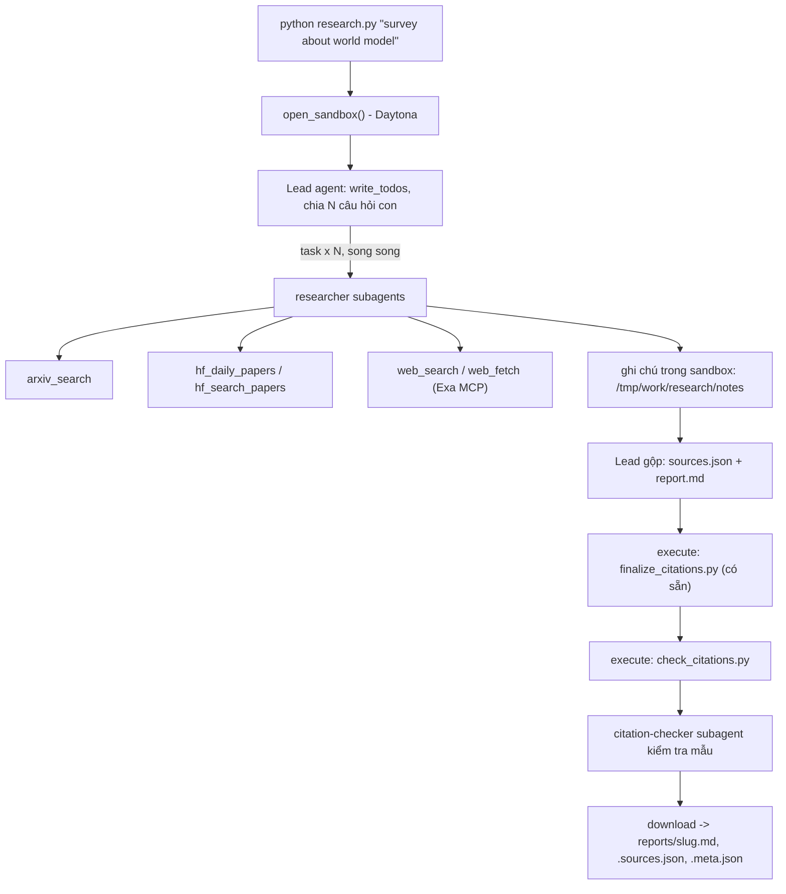

# Deep Research Agent (Deep Agents + Sandbox)

Lab dựng một **hệ thống deep research đa tác tử**: người dùng chỉ cần nhập một chủ đề (ví dụ `survey about world model`), hệ thống tự lập kế hoạch, giao việc cho nhiều subagent, tìm tài liệu trên arXiv, Hugging Face và web, rồi viết một **báo cáo có trích dẫn**.

Hình thức: **bài thực hành cá nhân**. Ngôn ngữ lập trình: Python 3.11 trở lên.

## 1. Mục tiêu học tập

Sau lab, bạn có thể:

1. Dựng agent bằng thư viện Deep Agents (LangChain): công cụ (tool), system prompt, subagent, backend.
2. Dùng **sandbox** (Daytona) làm không gian làm việc và nơi chạy mã cho agent; hiểu vì sao khóa API và công cụ mạng phải nằm ở phía host chứ không nằm trong sandbox.
3. Viết công cụ gọi API ngoài **chịu được giới hạn tốc độ** (retry, backoff, jitter, `Retry-After`).
4. Thiết kế quy trình đa tác tử: lead chia nhỏ câu hỏi, giao cho N researcher chạy song song, tổng hợp và kiểm tra trích dẫn.
5. Tạo báo cáo có thể kiểm chứng: mọi khẳng định có `[n]` trỏ tới một nguồn có thật.

## 2. Hệ thống làm gì



Nguồn dữ liệu:

| Nguồn | Dùng để |
|---|---|
| arXiv API `https://export.arxiv.org/api/query` | Tìm bài theo từ khóa, sắp theo ngày |
| Hugging Face Daily Papers `/api/daily_papers` | Bài đang "trending": upvotes, githubRepo, summary |
| Hugging Face papers search `/api/papers/search?q=` | Tìm bài theo chủ đề |
| Web qua Exa MCP (`web_search_exa`, `web_fetch_exa`) | Blog, survey, trang dự án, nội dung đầy đủ của một URL |

## 3. Cấu trúc thư mục

```
Lab/
├── README.md  GUIDE.md  RUBRIC.md  REPORT_TEMPLATE.md   tài liệu
├── topics.md                 5 chủ đề cần chạy
├── requirements.txt  .env.example  .gitignore
├── model.py                  CÓ SẴN - không sửa: tạo mô hình LLM từ biến môi trường
├── sandbox.py                CÓ SẴN - không sửa: sandbox Daytona (hoặc Docker), upload, download
├── self_check.py             CÓ SẴN - không sửa: tự kiểm tra trước khi nộp (python self_check.py)
├── finalize_citations.py     CÓ SẴN - không sửa: script chạy trong sandbox, tự sinh `## References` và đánh số lại trích dẫn
├── tools.py                  SINH VIÊN CÀI ĐẶT: retry + 5 công cụ nguồn dữ liệu
├── agents.py                 SINH VIÊN CÀI ĐẶT: prompt, subagent, lead agent
├── research.py               SINH VIÊN CÀI ĐẶT: script chính
├── check_citations.py        SINH VIÊN CÀI ĐẶT: kiểm tra trích dẫn, chạy TRONG sandbox
└── reports/                  báo cáo sinh ra (bạn commit vào repo nộp)
```

Mỗi tệp "SINH VIÊN CÀI ĐẶT" là **pseudo-code chạy được** (import được): các hàm có docstring mô tả việc cần làm, các `TODO n` đánh số theo `GUIDE.md`, thân hàm đang `raise NotImplementedError`.

## 4. Cài đặt

```bash
python3 -m venv .venv && source .venv/bin/activate      # Python 3.11+
pip install -r requirements.txt
cp .env.example .env                                     # rồi điền khóa CỦA BẠN
```

Bạn cần ba loại khóa (điền vào `.env`, **không bao giờ commit** `.env`):

| Khóa | Lấy ở đâu | Ghi chú |
|---|---|---|
| LLM (`LAB_MODEL` + khóa nhà cung cấp) | Nhà cung cấp bạn chọn (OpenAI, Anthropic, Google, OpenRouter, Ollama...) | Mô hình **phải hỗ trợ tool calling**. Chép tên mô hình từ tài liệu của nhà cung cấp. |
| `DAYTONA_API_KEY` | https://app.daytona.io | Kiểm tra gói miễn phí / credit hiện hành. Không có tài khoản hoặc hết credit: đặt `SANDBOX=docker` để chạy sandbox trong container Docker cục bộ (xem `.env.example`). |
| `EXA_API_KEY` (khuyến nghị) | https://dashboard.exa.ai/api-keys | Có thể chạy không khóa, nhưng bản miễn phí của MCP bị giới hạn tốc độ rất nhanh. |

## 5. Làm bài

Làm theo thứ tự (chi tiết trong `GUIDE.md`):

1. `check_citations.py`: khởi động nhẹ, thuần Python.
2. `tools.py`: viết `with_retry` và 5 công cụ. Thử riêng từng công cụ: `python tools.py`.
3. `agents.py`: viết prompt, subagent và lead agent.
4. `research.py`: ghép tất cả; chạy một chủ đề:

```bash
python research.py "survey about world model"
```

Kết quả nằm ở `reports/survey-about-world-model.md` cùng `.sources.json` và `.meta.json`.

## 6. Chủ đề và nộp bài

- Chạy đủ **5 chủ đề** trong [`topics.md`](topics.md), mỗi chủ đề một lần.
- Commit mã nguồn và toàn bộ `reports/`, đẩy lên một **public repo** GitHub và nộp link.
- Kiểm tra trước khi nộp: chạy **`python self_check.py`** (không tốn token): nó kiểm tra đủ 5 báo cáo, `meta.json`, trích dẫn bằng `check_citations.py` của bạn, và không có `.env`/khóa nào trong git.
- Cách chấm: xem [`RUBRIC.md`](RUBRIC.md).

## 7. Thời gian, chi phí và an toàn

- Dùng một mô hình **rẻ nhưng hỗ trợ tool calling**, và **đặt giới hạn** (số lần gọi mô hình/công cụ cho lead và subagent, `recursion_limit`): một prompt hỏng có thể khiến agent lặp rất lâu. Đây là hạng mục 2.5 của `RUBRIC.md`.
- Kết quả có tính ngẫu nhiên: cùng một mã có thể cho báo cáo hợp lệ ở lần này và trích dẫn lỗi ở lần sau. Hãy sửa **prompt và mã**, không sửa tay báo cáo.

- Mỗi lần chạy tốn token LLM và thời gian sandbox. `tokens` trong `meta.json` chỉ đếm tin nhắn của lead, chưa gồm subagent, nên chi phí thật cao hơn. `open_sandbox()` luôn dừng và xóa sandbox khi kết thúc, kể cả khi lỗi. Đừng bỏ qua nó.
- **Không đưa bí mật vào sandbox.** Sandbox không ngăn được prompt injection hay việc đẩy dữ liệu ra mạng; một trang web độc hại có thể khiến agent chạy lệnh bên trong sandbox. Vì vậy mọi công cụ gọi mạng và mọi khóa ở lại phía host.
- Nội dung lấy từ web là **dữ liệu không đáng tin**: agent không được làm theo chỉ dẫn nằm trong đó.

## 8. Bản triển khai của Phạm Thanh Trung — 2A202602949

Đã triển khai các TODO trong `check_citations.py`, `tools.py`, `agents.py`, `research.py`.
Các tệp có sẵn `model.py`, `sandbox.py`, `self_check.py`, `finalize_citations.py` giữ nguyên.

### Chạy trên Windows PowerShell

```powershell
python -m venv .venv
.venv/Scripts/python.exe -m pip install -r requirements.txt
Copy-Item .env.example .env
# Điền cấu hình LLM của bạn vào .env; mô hình phải hỗ trợ tool calling.
# Khi dùng Docker: bật Docker Desktop, đặt SANDBOX=docker trong .env.
docker pull python:3.12-slim
.venv/Scripts/python.exe research.py "survey about world model"
.venv/Scripts/python.exe self_check.py
```

Với Gemini, cấu hình `LAB_MODEL=google_genai:<model hỗ trợ tool calling>` và `GOOGLE_API_KEY`;
không cần thêm SDK ngoài các dependency được cài từ `requirements.txt`.
Không đặt `LAB_TEMPERATURE` nếu nhà cung cấp dùng sampling cố định.
Với Azure OpenAI, điền `LAB_BASE_URL=https://<resource>.openai.azure.com/openai/v1/`,
`LAB_MODEL=<tên deployment>` và `LAB_API_KEY=<khóa của bạn>` trong `.env`.
Khi chuyển về Gemini, xoá cấu hình `LAB_BASE_URL` để chọn đúng nhánh provider.
`web_fetch` thử Exa rồi đọc trực tiếp trang nguồn nếu dịch vụ không truy cập được.
Khi Exa đang bị giới hạn, có thể đặt `LAB_WEB_FETCH_DIRECT=1` để đọc trực tiếp ngay;
HTML được bỏ script/style và PDF được đọc bằng `pypdf`, toàn bộ ở host.
Nếu đã xác nhận Exa search hết hạn mức, `LAB_EXA_UNAVAILABLE=1` trả lỗi ngay để
researcher chuyển nguồn; xoá cờ này khi dịch vụ hồi phục. Có `EXA_API_KEY` thì
web search vẫn thử Exa bình thường. Các cờ này là tùy chọn, không bật mặc định.
Docker chỉ là backend sandbox được đề cho phép: container không có mạng, giới hạn RAM/CPU,
tự xoá khi kết thúc; các công cụ mạng và khoá API ở host.

Lead có trần 90 lần gọi model/180 lần gọi tool; researcher 30/50; citation-checker 24/45.
Giới hạn graph lead là 1.000 bước. Đây là trần số lượt, không phải cam kết chi phí;
`tokens` trong metadata chỉ đếm lead, chưa bao gồm subagent.
Middleware của lead từ chối giao một researcher riêng lẻ trước khi có một lượt
giao ít nhất ba researcher cùng nhau. Các lần chạy mới lưu `parallel_researcher_batch`
trong metadata và `message_index` trong trace để đối chiếu việc giao song song.

### Đọc kết quả

Mỗi chủ đề sinh `<slug>.md`, `.sources.json`, `.meta.json` như đề yêu cầu. Hai tệp bằng chứng
bổ sung `.audit.md` và `.trace.json` giữ bản đối chiếu toàn bộ tiêu đề/URL nguồn,
kiểm tra mẫu các nhận định của citation-checker và các lời gọi
tool của lead để thấy việc giao việc. Nội dung báo cáo và nguồn là đúng byte tải từ sandbox;
không sửa tay sau khi chạy. Lần chạy thiếu nguồn, thiếu audit hoặc trích dẫn sai sẽ thoát mã 1.

Chạy cả 5 chủ đề trong `topics.md`, rồi dùng `self_check.py` trước khi nộp.
Script kiểm tra lại cấu trúc báo cáo và trích dẫn sau khi agent kết thúc; nếu có lỗi,
lead có tối đa hai lượt sửa tiếp trong sandbox. Audit lưu chẩn đoán của checker;
trace ghi các bước sửa sau audit, nên cần đọc hai tệp cùng nhau.

### Kết quả nộp Lab23

Đã chạy đủ 5 chủ đề; `self_check.py` trả `OK` cho cả 5 và kiểm tra git/khóa.
Báo cáo world model có một lượt sửa cuối hoàn tất trong sandbox nhưng bước lưu
thống kê trên host lỗi giải mã UTF-8. Báo cáo, nguồn và audit được khôi phục nguyên
byte từ snapshot đã tải; metadata ghi rõ thống kê tổng không bao gồm lượt sửa đó.
Audit efficient inference ghi nhận nguồn không truy cập được trong lượt checker;
đã đối chiếu thủ công ít nhất ba trích dẫn với trang nguồn chính thức theo rubric.
Các kiểm tra tự động không thay thế điểm chấm nội dung của giảng viên.
